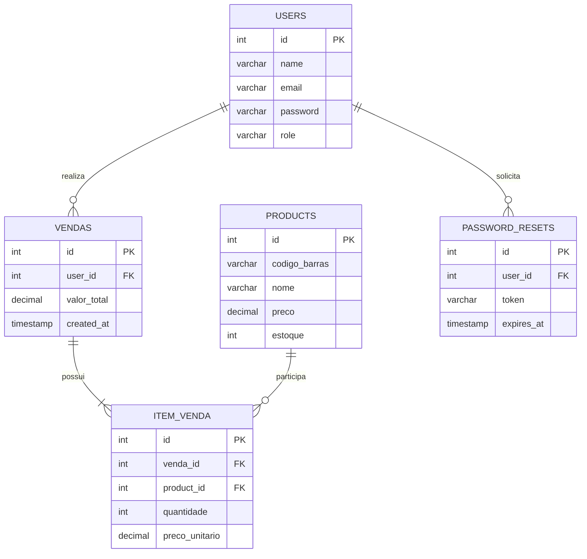

# Sistema de Gestão de Estoque e Vendas

## 1. Sobre o projeto

O Sistema de Gestão de Estoque e Vendas é uma API REST desenvolvida para auxiliar no gerenciamento de produtos e vendas de uma loja.

A aplicação permite realizar o cadastro e a consulta de produtos, controlar as quantidades disponíveis no estoque e registrar vendas. Também possui autenticação de usuários, controle de acesso por perfil e integração com uma API externa para consulta de endereços por CEP.

## 2. Tecnologias utilizadas

- Node.js
- JavaScript
- Express
- PostgreSQL
- JSON Web Token (JWT)
- bcrypt
- Docker
- Docker Compose
- ViaCEP

## 3. Funcionalidades

- Cadastro e autenticação de usuários.
- Autenticação utilizando JWT.
- Controle de acesso por perfil: ADMIN e USER.
- Cadastro, consulta, atualização e exclusão de produtos.
- Registro de vendas.
- Atualização automática do estoque após uma venda.
- Validação da quantidade disponível antes de concluir uma venda.
- Consulta de endereço por CEP utilizando a API ViaCEP.
- Tratamento global de erros.

## 4. Perfis de acesso

### ADMIN
- Cadastrar produtos.
- Consultar produtos.
- Atualizar informações dos produtos.
- Excluir produtos.
- Acessar as funcionalidades permitidas aos usuários autenticados.

### USER
- Consultar produtos.
- Registrar vendas.
- Acessar as funcionalidades permitidas ao seu perfil.

## 5. Modelo de dados (DER)

O banco de dados utiliza tabelas relacionadas para armazenar usuários, produtos, vendas, itens das vendas e solicitações de redefinição de senha.



## 6. Rotas da API

### Autenticação

| Método | Rota | Descrição |
|---|---|---|
| POST | `/auth/register` | Cadastro de usuário |
| POST | `/auth/login` | Autenticação de usuário |
| POST | `/auth/forgot-password` | Solicitação de redefinição de senha |
| POST | `/auth/reset-password` | Redefinição de senha |

### Produtos

| Método | Rota | Descrição | Permissão |
|---|---|---|---|
| GET | `/products` | Lista os produtos | Autenticado |
| GET | `/products/:id` | Consulta produto por ID | Autenticado |
| POST | `/products` | Cadastra produto | ADMIN |
| PUT | `/products/:id` | Atualiza produto | ADMIN |
| DELETE | `/products/:id` | Exclui produto | ADMIN |

### Vendas

| Método | Rota | Descrição | Permissão |
|---|---|---|---|
| POST | `/vendas` | Registra uma venda | Autenticado |
| GET | `/vendas` | Lista as vendas | Autenticado |

### Consulta de CEP

| Método | Rota | Descrição | Permissão |
|---|---|---|---|
| GET | `/cep/:cep` | Consulta endereço por CEP | Pública |

## 7. Regras de negócio

- O cadastro público de usuários utiliza o perfil USER.
- Somente administradores podem cadastrar, atualizar e excluir produtos.
- Uma venda não pode ser concluída quando a quantidade solicitada for superior ao estoque disponível.
- Após uma venda válida, a quantidade vendida é descontada automaticamente do estoque.
- Em caso de erro durante o processamento de uma venda, as alterações são revertidas para preservar a consistência dos dados.
- As rotas protegidas exigem autenticação por token JWT.

## 8. Integração com API externa

O sistema utiliza a API ViaCEP para consultar informações de endereço a partir de um CEP.

A integração permite obter dados como:

- CEP;
- Logradouro;
- Bairro;
- Cidade;
- Unidade federativa (UF).

Documentação da API utilizada: https://viacep.com.br/

## 9. Instalação e execução

### Pré-requisitos

- Node.js
- Docker
- Docker Compose
- Git

### Clonagem do repositório

```bash
git clone https://github.com/dhenyffer-arantes/sistema-estoque.git
cd sistema-estoque
```

### Configuração do ambiente

As variáveis de ambiente necessárias para a execução da aplicação estão descritas no arquivo `.env.example`.

### Execução com Docker

```bash
docker compose up --build
```

Para executar os containers em segundo plano:

```bash
docker compose up --build -d
```

Para verificar os containers em execução:

```bash
docker compose ps
```

Para encerrar a aplicação:

```bash
docker compose down
```

## 10. Links do projeto

- **Repositório GitHub:** [INSERIR LINK]
- **API em produção (Render):** https://sistema-estoque-api-a52f.onrender.com
- **Collection do Postman:** [INSERIR LINK DO ARQUIVO OU DA COLLECTION]
- **Documentação adicional:** [INSERIR LINK, SE HOUVER]

## 11. Collection do Postman

A Collection do Postman reúne as requisições utilizadas para testar as funcionalidades da API, incluindo autenticação, gerenciamento de produtos, registro de vendas e consulta de CEP.

**Arquivo:** [INSERIR CAMINHO OU NOME DO ARQUIVO]

## 12. Autoria

Projeto acadêmico desenvolvido por:

**Nome:** Dhenyffer Caroline Almeida Arantes
