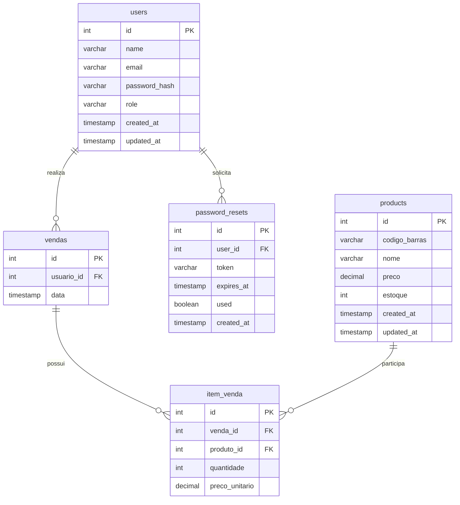

# Sistema de Gerenciamento de Estoque e Vendas

## 1. Sobre o projeto

O Sistema de Gerenciamento de Estoque e Vendas é uma API REST desenvolvida para auxiliar no controle de produtos, estoque e registro de vendas de uma loja.

O sistema permite cadastrar e gerenciar produtos, controlar as quantidades disponíveis em estoque e registrar vendas, realizando a atualização automática do estoque.

Também possui autenticação de usuários, controle de permissões por perfil e integração com a API ViaCEP.

## 2. Tecnologias utilizadas

- Node.js
- Express
- PostgreSQL
- JavaScript
- JWT (autenticação)
- Bcrypt (criptografia de senhas)
- Docker
- Render
- ViaCEP
- Postman

## 3. Funcionalidades

- Cadastro e autenticação de usuários.
- Login com geração de token JWT.
- Controle de acesso por perfil de usuário.
- Cadastro, consulta, atualização e exclusão de produtos.
- Controle de quantidade de produtos em estoque.
- Registro de vendas.
- Atualização automática do estoque após uma venda.
- Consulta do histórico de vendas.
- Recuperação e redefinição de senha.
- Consulta de endereço por CEP utilizando a API ViaCEP.

## 4. Perfis de usuário

O sistema possui dois níveis de acesso:

**ADMIN**
- Cadastrar produtos.
- Listar e consultar produtos.
- Atualizar produtos.
- Excluir produtos.
- Registrar vendas.
- Consultar vendas.

**USER**
- Consultar produtos.
- Consultar vendas.
- Registrar vendas.

As operações protegidas exigem autenticação por token JWT.

## 5. Estrutura do banco de dados

O banco de dados PostgreSQL possui cinco tabelas principais:

- `users`: armazena os dados dos usuários.
- `products`: armazena os produtos e suas informações de estoque.
- `vendas`: registra as vendas realizadas.
- `item_venda`: armazena os produtos e quantidades de cada venda.
- `password_resets`: armazena os registros relacionados à redefinição de senhas.

### Diagrama Entidade-Relacionamento (DER)



## 6. Rotas da API

### Autenticação — `/auth`

| Método | Rota | Descrição |
|---|---|---|
| POST | `/auth/register` | Cadastro de usuário |
| POST | `/auth/login` | Login |
| POST | `/auth/forgot-password` | Solicitação de recuperação de senha |
| POST | `/auth/reset-password` | Redefinição de senha |

### Produtos — `/products`

| Método | Rota | Descrição |
|---|---|---|
| GET | `/products` | Listar produtos |
| GET | `/products/:id` | Consultar produto por ID |
| POST | `/products` | Cadastrar produto |
| PUT | `/products/:id` | Atualizar produto |
| DELETE | `/products/:id` | Excluir produto |

### Vendas — `/vendas`

| Método | Rota | Descrição |
|---|---|---|
| POST | `/vendas` | Registrar venda |
| GET | `/vendas` | Listar vendas |

### Consulta de CEP — `/cep`

| Método | Rota | Descrição |
|---|---|---|
| GET | `/cep/:cep` | Consultar endereço pelo CEP |

## 7. Regras de negócio

- O acesso às rotas protegidas é realizado por autenticação JWT.
- As operações de gerenciamento de produtos são restritas ao perfil ADMIN.
- Ao registrar uma venda, a quantidade correspondente é descontada do estoque.
- O sistema realiza validações para evitar vendas com quantidades inválidas ou superiores ao estoque disponível.
- Os itens de uma venda são relacionados aos produtos cadastrados no banco de dados.

## 8. Integração com ViaCEP

O sistema possui integração com a API ViaCEP para consultar informações de endereço a partir de um CEP.

A consulta retorna informações como:

- CEP
- Logradouro
- Bairro
- Cidade
- Estado

## 9. Execução do projeto

O projeto utiliza Docker para facilitar a configuração e execução da aplicação e do banco de dados.

Com o Docker instalado, execute:

```bash
docker compose up --build
```

A API utiliza a porta `3000` para execução local.

## 10. Links do projeto

**Repositório GitHub:**

https://github.com/dhenyffer-arantes/sistema-estoque

**API hospedada no Render:**

https://sistema-estoque-api-a52f.onrender.com

## 11. Collection do Postman

A Collection contém as requisições utilizadas para testar as funcionalidades e rotas da API.

[Visualizar Collection do Postman](./sistema-estoque-collections-postman.json)

## 12. Autoria

**Desenvolvedora:** Dhenyffer Caroline Almeida Arantes

**Projeto:** Sistema de Gerenciamento de Estoque e Vendas