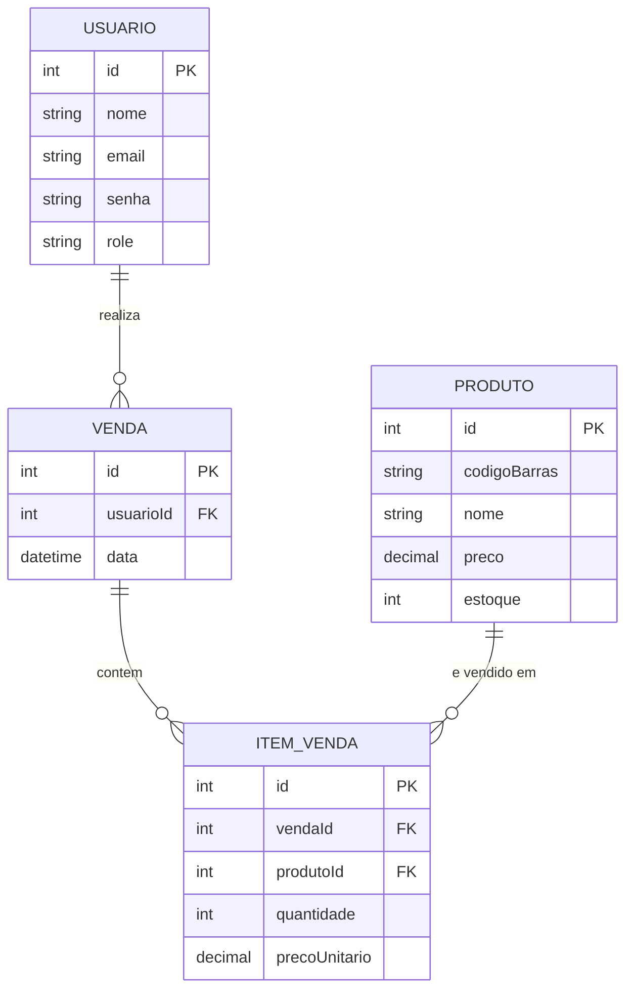

# Sistema de Gerenciamento de Estoque e Vendas

## Escopo

Este projeto é um sistema de gerenciamento de estoque e vendas voltado para
pequenos comércios de variedades. Ele resolve um problema real observado em
uma loja onde todo o controle era feito manualmente: não havia registro de
quantas peças existiam em estoque, quantas foram vendidas de cada produto,
nem qual vendedora realizou cada venda — informação importante, já que as
vendedoras recebem comissão sobre o valor vendido.

O sistema permite:
- Cadastro de produtos por código de barras, com controle de estoque;
- Registro de vendas associadas ao usuário (vendedora) autenticado;
- Consulta de histórico de vendas e cálculo de comissão por vendedora;
- Dois perfis de acesso: **Administrador** (gerencia produtos, usuários e
  relatórios) e **Vendedor** (registra vendas).

## Diagrama de Entidade-Relacionamento (DER)

